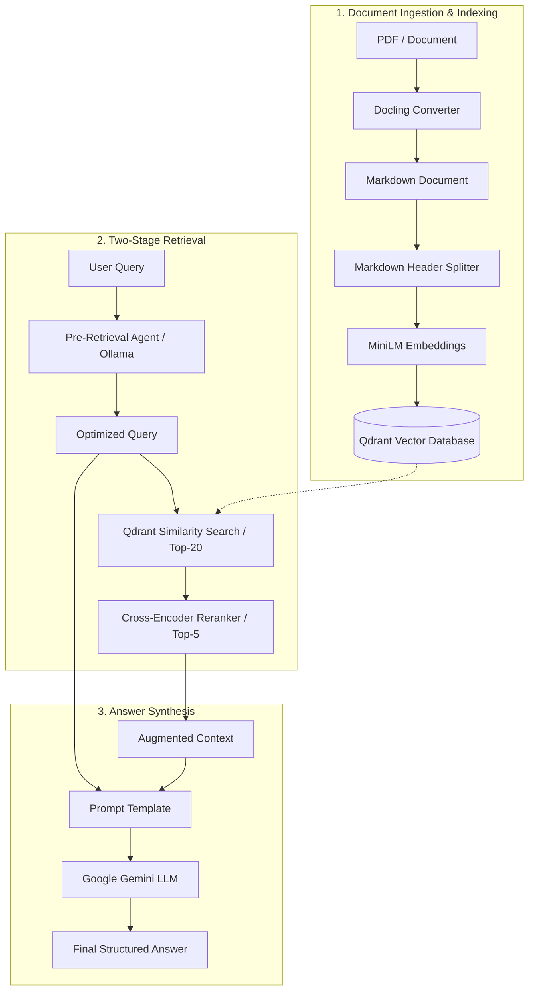

# Advanced Hybrid RAG Pipeline

A production-ready Retrieval-Augmented Generation (RAG) system featuring document parsing with Docling, semantic vector indexing with Qdrant, agentic query rewriting with Ollama, cross-encoder reranking, Google Gemini answer generation, Streamlit web preview, and automated evaluation using Ragas.

---

## Architecture Overview



---

## Key Features

- **Document Parsing with Docling**: High-fidelity conversion of complex PDF documents into structured Markdown preserving hierarchical headings and layouts.
- **Header-Aware Chunking**: Uses `MarkdownHeaderTextSplitter` to retain semantic structure across sections.
- **Vector Storage in Qdrant**: High-performance vector indexing with `sentence-transformers/all-MiniLM-L6-v2`.
- **Pre-Retrieval Query Optimization**: Formulates optimized queries using local LLMs (Ollama `llama3.2`) before vector search.
- **Cross-Encoder Reranking**: Re-scores candidate chunks with `cross-encoder/ms-marco-MiniLM-L6-v2` for maximum precision.
- **LLM Generation**: Leverages Google Gemini for grounded, context-driven synthesis.
- **Synthetic Evaluation**: Built-in test set generator powered by Ragas and Ollama (`qwen2.5:7b`).
- **Interactive UI**: Streamlit application for inspecting parsed documents and markdown outputs.

---

## Project Structure

```
.
├── .env.example              # Environment variables template
├── .gitignore                # Git ignore rules (secrets, caches, outputs)
├── README.md                 # Project documentation
├── requirements.txt          # Python dependencies
├── data/                     # Sample input documents
│   └── 1706.03762v7.pdf      # Sample paper ("Attention Is All You Need")
├── outputs/                  # Generated files and evaluation reports
│   └── .gitkeep              # Keeps folder tracked while outputs are gitignored
└── src/                      # Source code
    ├── __init__.py           # Package marker
    ├── app.py                # Streamlit web interface
    ├── evaluate_ragas.py     # Ragas synthetic test set generator
    └── rag_pipeline.py       # Core Advanced RAG pipeline
```

---

## Prerequisites

1. **Python 3.10+** (tested on Python 3.13)
2. **Qdrant Vector Database**:
   Run Qdrant locally using Docker:
   ```bash
   docker run -d -p 6333:6333 -p 6334:6334 qdrant/qdrant
   ```
3. **Ollama**:
   Install [Ollama](https://ollama.ai) and pull the models used by the pipeline:
   ```bash
   ollama pull llama3.2:latest
   ollama pull qwen2.5:7b
   ```
4. **Google Gemini API Key**:
   Get an API key from [Google AI Studio](https://aistudio.google.com/).

---

## Installation & Setup

1. **Clone the repository:**
   ```bash
   git clone <your-github-repo-url>
   cd <repo-folder>
   ```

2. **Create and activate a virtual environment:**
   ```bash
   python3 -m venv .venv
   source .venv/bin/activate  # On Windows: .venv\Scripts\activate
   ```

3. **Install dependencies:**
   ```bash
   pip install -r requirements.txt
   ```

4. **Configure environment variables:**
   Copy `.env.example` to `.env`:
   ```bash
   cp .env.example .env
   ```
   Edit `.env` with your credentials:
   ```env
   # LangSmith / LangChain Tracing (optional)
   LANGCHAIN_API_KEY=your_langchain_api_key
   LANGCHAIN_TRACING_V2=true
   LANGCHAIN_PROJECT=ADVANCED_RAG

   # Google Gemini API Key (required)
   GEMINI_API_KEY=your_gemini_api_key

   # Qdrant Vector Store
   QDRANT_URL=http://localhost:6333
   QDRANT_COLLECTION_NAME=Hybrid-RAG

   # Ollama Models
   OLLAMA_MODEL=llama3.2:latest
   OLLAMA_EVAL_MODEL=qwen2.5:7b
   ```

---

## Usage

### 1. Run the RAG Pipeline
Index a document, optimize your prompt, rerank passages, and generate an answer:
```bash
python src/rag_pipeline.py
```
> When prompted, press **Enter** to use the default sample PDF (`data/1706.03762v7.pdf`), or provide a custom file path.

### 2. Run the Streamlit Viewer
Preview Markdown and text files in an interactive web interface:
```bash
streamlit run src/app.py
```

### 3. Generate Ragas Synthetic Testset
Generate test question-context pairs for benchmark evaluation:
```bash
python src/evaluate_ragas.py
```
> Results will be saved automatically to `outputs/ragas_testset.csv`.

---

## Pushing to GitHub

To push this repository to GitHub for the first time:

1. Create a new empty repository on [GitHub](https://github.com/new).
2. Run the following commands in your project root:
   ```bash
   git add .
   git commit -m "Initial commit: Reorganized Advanced RAG pipeline"
   git branch -M main
   git remote add origin https://github.com/<your-username>/<your-repo-name>.git
   git push -u origin main
   ```

> [!IMPORTANT]
> Your `.env` file contains secret API keys and is excluded via `.gitignore`. Never commit `.env` to GitHub. Always use `.env.example` to document required environment variables.
